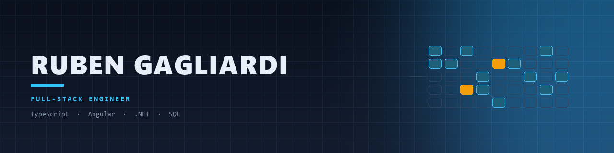
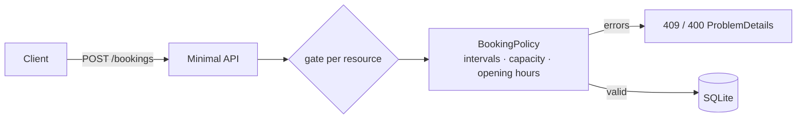

<p align="center">
  
</p>

# Ruben Gagliardi

**Full-stack engineer** — eight years shipping products end to end, from the database to the interface, and
the automation around them.


I have spent most of those years building software **for a business I was also running**: bookings, customers,
money, documents, deadlines. That shapes how I work — I care whether the thing survives a Tuesday afternoon,
not whether the demo looks good.

> **About the code.** Everything below is real software I use, around 160 tools across six areas. The source
> stays **private**: I am advertising what I can do, not giving away the implementations. Read the evidence,
> then ask me anything — I am glad to walk through the design in a call.

## At a glance

| | |
|---|---|
| **Years shipping** | 8 |
| **Front** | TypeScript · Angular · React |
| **Back** | C# / .NET · Node.js · SQL |
| **Also** | browser automation (CDP) · document pipelines · AI-assisted development |
| **Verification habit** | every claim in this page has a number, a test or a command behind it |

## How I work with AI

Everyone lists "AI" now. The interesting part is the discipline around it, and it is the part I can show:

- **Rules before actions.** A script that touches a mailbox or a browser gets its limits written first:
  *never modify or delete a message*, *closes only the tabs it opened itself*. Rules that say "never", not
  "usually".
- **Proof, not hope.** Every moved file carries a SHA-256 hash; every automated step leaves a screenshot or a
  log line. If I cannot prove it happened, it did not happen.
- **The model does not decide the truth.** Numbers in a report are read from the source of record, not from
  memory — the version of an application comes from the registry, not from a note about it.
- **Human hand-off where it belongs.** CAPTCHA, passwords, payments, signatures: the automation stops and a
  person takes over, by design.
- **Written-down limits.** Every design note says where the solution stops working. See the slot engine below.

## Selected engineering decisions

**1. Half-open intervals, or nothing.** A booking from 10:00 to 11:00 does not overlap 11:00 to 12:00, and
that single `[start, end)` choice removes a whole family of bugs at the root. Six tests exist just to keep it
true.

**2. The check is not the guarantee.** In the slot engine, "look if it is free, then insert" is a race. I
serialise the booking per resource — and then I write down that this is correct on SQLite and **not enough**
with two instances: there the invariant has to live in the database (an exclusion constraint). Naming your own
limit is cheaper than being asked about it in an interview.

**3. A hash is cheaper than trust.** In the mailbox archive, every file moved gets an entry with its SHA-256
and where it landed. Months later, "did this file change?" is a query, not an argument.

## What I have built

### Booking engine — no double bookings
API and dashboard for booking slots on shared resources. The invariant is the product: two people asking for
the same slot at the same moment — exactly one wins.

```http
POST /bookings   {"resourceId":"arena-1","date":"2026-12-01","start":"14:00:00","end":"16:00:00","people":12}
201 Created      {"id":"7cddaac1-…","resourceId":"arena-1","start":"14:00:00","end":"16:00:00","status":"confirmed"}

POST /bookings   {"resourceId":"arena-1","date":"2026-12-01","start":"15:00:00","end":"17:00:00","people":8}
409 Conflict     {"type":"slot-already-booked","errors":{"OverlapsExistingBooking":["That slot is already booked."]}}
```

`ASP.NET Core` · `EF Core + SQLite` · `xUnit` · `Angular` — **19 automated tests**, including
`TwoRequestsForTheSameSlot_ExactlyOneWins`.



### Browser automation over the DevTools Protocol
Twenty scripts that drive a real Chrome where there is no API: long forms, portals, screenshots as evidence.
Tab registry, CAPTCHA hand-off, and a rule that a script only ever closes the tabs it opened itself.

### Mailbox and Drive automation
Archive and inventory built around one promise: never modify or delete a message. Dated folders, a hash per
moved file, a map of where everything went, counts verified before and after.

### Document pipeline
**31,638 files inventoried, 8,442 documents indexed** at the last run: PDF text extraction, OCR, and one query
that answers "where is that document".

### One CV, many variants
A single source of truth, with generators for each targeted variant and the Europass format — a fact is fixed
once and never contradicts itself in another document.

### Operations bookkeeping
Deadline register, outstanding items with ownership and claims, a dashboard of what is stuck and for how long,
and a weekly backup that verifies its own archive.

## What I would do differently

- I would have put the tests first in the first year, not the fifth: most of what I fixed later was a rule
  that had never been written down.
- I would have kept a public notebook from the start. This page should have existed three years ago, and the
  reason it did not is always the same: the work was urgent and the writing was not.

## What I'm working on

A dated log of what shipped, what is next, and what I am studying: **[NOW.md](NOW.md)** — updated when
something actually changes, not when I feel like writing.

## Currently

Looking for a **remote senior full-stack** role: TypeScript / Angular / React with a .NET and SQL backbone.
The full CV is available on request.
