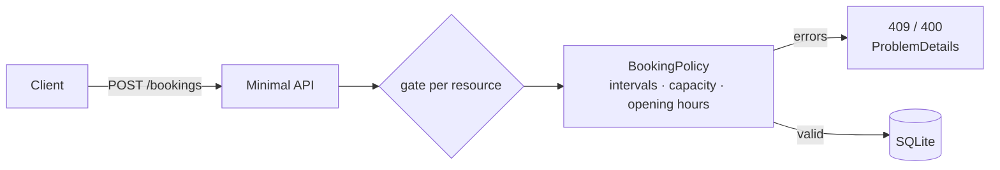
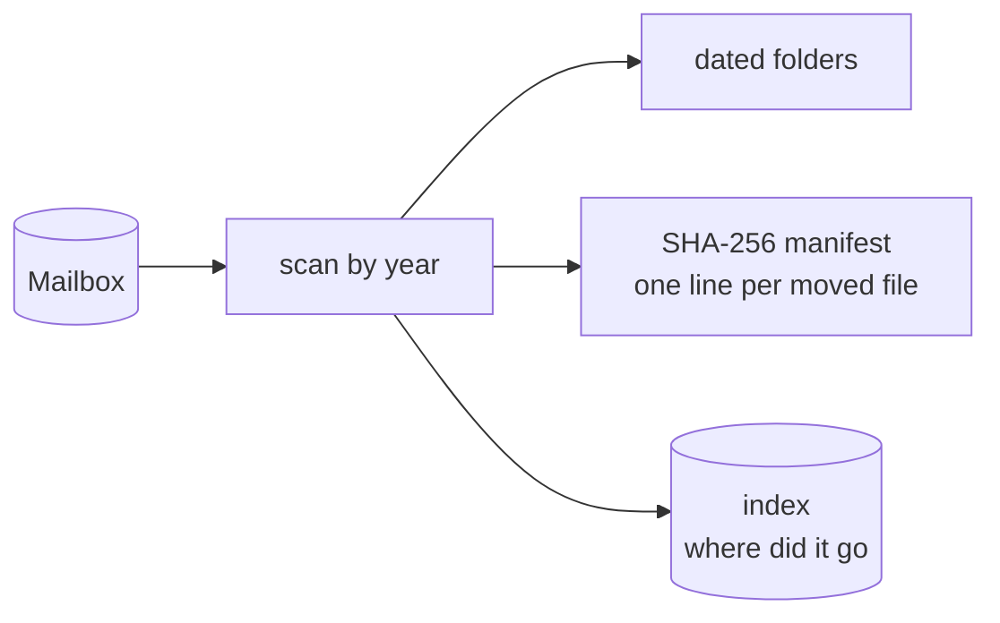

# Ruben Gagliardi — full-stack engineer

I build products end to end: **TypeScript / Angular / React** on the front, **C# / .NET and SQL** on the back,
plus the automation and the document pipelines that keep a small business running. Eight years of shipping,
most of them running technology for a business I also ran.

> **About the code.** Everything below is real, working software — around 160 tools across six areas. The
> source stays **private**: I am advertising what I can do, not giving away the implementations. Read the
> descriptions, look at the evidence, ask me anything — I am glad to walk through the design in a call.

---

## 1. Slot engine — booking without double bookings

An API and dashboard for booking time slots on shared resources (arenas, rooms, coaches): opening hours,
capacity, half-open intervals, cancellations that keep history.

The interesting part is not the CRUD, it is the invariant: **two people asking for the same slot at the same
moment must not both get it.** Exactly one request wins, the other gets a conflict with a reason.

```http
POST /bookings            {"resourceId":"arena-1","date":"2026-12-01","start":"14:00:00","end":"16:00:00","people":12}
201 Created
{"id":"7cddaac1-…","resourceId":"arena-1","date":"2026-12-01","start":"14:00:00","end":"16:00:00",
 "people":12,"customerName":"Demo Customer","status":"confirmed"}

POST /bookings            {"resourceId":"arena-1","date":"2026-12-01","start":"15:00:00","end":"17:00:00","people":8}
409 Conflict
{"type":"slot-already-booked","errors":{"OverlapsExistingBooking":["That slot is already booked on this resource."]}}
```



**Stack.** ASP.NET Core minimal API · EF Core + SQLite · xUnit · Angular
**Evidence.** 19 automated tests — 12 on the domain rules, 7 through HTTP, including the concurrency one
(`TwoRequestsForTheSameSlot_ExactlyOneWins`).

## 2. Browser automation over the DevTools Protocol

Twenty scripts that drive a real Chrome the way a person would, for the work that has no API: filling long
forms, clicking through portals, taking screenshots as evidence. The rules matter more than the automation:

- one **tab registry**: a script only ever closes the tabs it opened itself — never the ones someone else is
  working in;
- hand-off on **CAPTCHA and OTP**, instead of pretending to solve them;
- every failed action is recorded with what was on screen at that moment.

`Node.js` · `Chrome DevTools Protocol` · no Selenium, no browser extension

## 3. Mailbox and Drive automation

A mailbox archive and a Drive census, built around one promise: **never modify or delete a message.**



- every archived year is written to dated folders with a hash for each moved file;
- a map of what moved where, so a file can be found again without reopening the mailbox;
- counts verified before and after: the archive carries its own evidence.

`Node.js` · `Gmail API` · `Drive API` · SHA-256 integrity

## 4. Document pipeline

Scan the folders, extract text from PDFs, read images, index everything, and answer "where is that document"
in one query: **31,638 files inventoried, 8,442 documents indexed** at the last run.

`Python` · `Node.js` · PDF text extraction · OCR · SQLite full-text search

## 5. One CV, many variants

A single source of truth for the CV, with generators that produce each targeted variant (and the Europass
format) from the same data — so a fact is fixed once and never contradicts itself in another document.

`Python` · data-driven document generation · PDF rendering

## 6. Operations bookkeeping

The unglamorous half: a deadline register, an outstanding-items register with ownership and claims, a
dashboard that says what is stuck and for how long, and a weekly backup that verifies its own archive.

`Node.js` · `SQLite` · scheduling · backups with verification

---

## How I work

- **Rules before code.** Intervals, uniqueness, capacity: written as tests before they become endpoints.
- **Small surface.** Minimal APIs, one error contract, no layer for the sake of a layer.
- **Boring operations.** Seeded fake data, reproducible runs, hashes instead of trust.
- **Limits written down.** Every design note says where the solution stops working — the per-resource gate in
  the slot engine is correct on SQLite and not enough on two instances: on PostgreSQL the same invariant needs
  an exclusion constraint, and the README says so.

## Currently

Looking for a **remote senior full-stack** role: TypeScript / Angular / React with a .NET and SQL backbone.

- The full CV is available on request.
